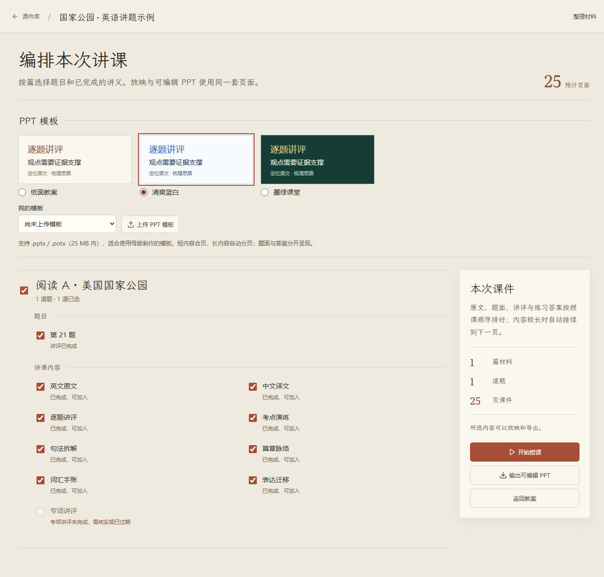

# 讲题工作台 · Lesson Desk

讲题工作台（Lesson Desk）是一款面向教师的试卷讲评与错题讲解软件，目前支持高中英语和语文，运行于 Windows。老师可以用它准备整卷讲评，也可以挑出几道需要重点讲解的错题，整理解析、补充练习，再编排成课堂课件。学生也能用它对照原文学习，梳理解题思路，复习自己不熟悉的内容。

**当前版本：0.15.0** · Electron / React / TypeScript · [MIT License](LICENSE)



## 可以做什么

备课从手头的试卷开始。软件支持导入 PDF、Word 文档，或直接粘贴试题与参考答案；扫描试卷可通过配置的在线识别服务处理。核对题目和材料后，老师按需要选择生成哪些讲解模块。已经生成的内容可以继续修改、保存并查看历史，未完成的任务也能接着处理。

讲英语试卷时，可以围绕题目整理答题依据，也能继续展开文章译文、长难句拆解和篇章分析。句法讲解会拆出句子主干与具体成分，篇章分析关注段落作用和行文逻辑。词汇手账保留单词在原文中的用法，结合语境义、搭配与例句复习；表达迁移则提供句式骨架和仿写任务，把阅读中遇到的表达用起来。

语文按材料和题目组织内容，覆盖阅读、文言文、诗歌、默写、语言运用与写作。老师可以结合原页图片核对材料，整理逐题讲评、文本脉络、语言品读或文言译注，也可以准备写作指导。多则材料能够关联到相应题目，讲义支持教师修订和确认。

针对选出的错题，还可以围绕原题考点生成新材料、新语境下的练习，用于课堂巩固或课后复习。学生自主学习时，可以先独立作答，再展开参考答案和解析，对照原文检查自己的理解；词汇回忆模式、仿写任务和考点演练，也提供了继续练习的入口。

准备上课时，老师自行选择要讲的篇目、题目和模块，按所需顺序编排。内容既能直接放映，也能导出为可编辑的 PPT，两种方式使用相同的页序。长内容自动分页，较短的内容块尽量合页，练习与答案分开呈现，方便课堂提问。PPT 提供纸面教案、清爽蓝白和墨绿课堂三种风格，也支持上传现成的 `.pptx`、`.potx` 模板，沿用模板的背景、配色和字体。

课件与修改记录保存在本机，也可导出课件包，留作后续讲评和复习使用。AI 生成功能需要配置自己的模型服务与 API Key；试卷识别、答案和生成的讲解仍需使用者核对。

## 运行与打包

主要支持 **Windows x64**。请安装 [Node.js 24 LTS](https://nodejs.org/)（包含 npm）和 [Git](https://git-scm.com/)。

```powershell
git clone https://github.com/zazedwhwhy/lesson-desk.git
cd lesson-desk
npm ci
npm run build
npm start
```

生成 Windows 安装包：

```powershell
npm run package
```

构建结果在 `release/`。源码仓库不提交依赖目录、安装包及个人课件。`npm run dev` 只启动浏览器界面预览；文件导入、保存与 AI 等桌面能力请通过 `npm run build` 后的 `npm start` 使用。

## 第一次使用

1. 打开预置示例，或新建课件并选择英语/语文。
2. 在“连接设置”填写服务地址、模型与自己的 API Key；示例浏览和本地测试不需要 API Key。
3. 上传试卷与参考答案，对照原卷核对题目、材料关联和答案，再勾选所需模块开始生成。
4. 核实生成内容，必要时保存教师修订版本。
5. 进入“输出课件”或“编排授课 / PPT”，勾选内容、选择模板，再放映或导出。

AI 请求会把本次任务所需的材料发送给你配置的服务商，可能产生费用；联网生成前请确认材料的使用权限和服务商设置。应用没有内置可供公众使用的 API Key。

## 数据与边界

课件、设置和模板保存在 Electron 的当前用户数据目录。API Key 通过 Electron `safeStorage` 加密，仍应保护好当前 Windows 账户和应用数据目录。课件包不包含 API 凭据。

PDF 阅读顺序由版面估算，扫描识别、材料整理和 AI 讲义均需教师对照原件核实。缺失、冲突或过期内容不会自动视为已确认。旧版 `.doc`、音频转写暂不支持。

自定义 PPT 读取母版/版式中的背景、装饰、主题与正文空间；模板示例文字不会进入课件。复杂效果、字体缺失和 PowerPoint 渲染差异请以实际打开结果为准。详见 [PPT 模板与紧凑分页](docs/PPT模板与紧凑分页-0.15.0.md) 和 [语文功能说明](docs/语文整卷功能-0.14.0.md)。

## 开发与验证

```powershell
npm test
npm run build
npm run check:public
```

测试使用本地合成材料和模拟请求，不要求真实 API 凭据。既有本地测试与打包程序验证通过，不代表任意服务商、整卷识别或任意 PPT 模板都已完成端到端验收。

GitHub Actions 在 `main` 推送和 Pull Request 时运行公开内容检查、测试及构建。具体协作方式见 [开发与 Git 工作流](docs/开发与Git工作流.md)；贡献要求见 [CONTRIBUTING](CONTRIBUTING.md)。

```text
src/core/       学科模型、校验、教学内容和共享分页
src/desktop/    Electron、材料导入、AI 调用、存储和 PPT 导出
src/ui/         React 界面
scripts/        构建及本地验证脚本
tests/          自动化测试
assets/fonts/   字体及其许可证
docs/           公开使用文档与开发指南
```

## 许可证与致谢

本项目自行编写的源码采用 [MIT](LICENSE)。随项目分发的 Literata 与霞鹜文楷按 SIL Open Font License 1.1 保留原授权；第三方组件及用户上传材料不因源码开源而改换许可。来源及声明见 [THIRD_PARTY_NOTICES](THIRD_PARTY_NOTICES.md)。
