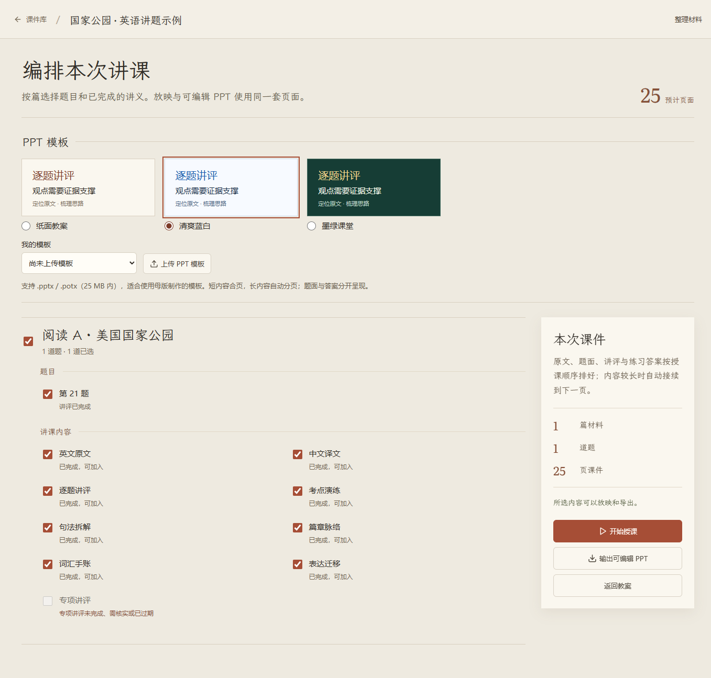

# Lesson Desk

[English](README.md) | [简体中文](README.zh-CN.md)

Prepare exam explanations and classroom slides from your own papers. Lesson Desk is a desktop app for teachers working with English, Chinese language and literature, and chemistry. Import a paper, check the questions and answers, generate the teaching material you need, then edit and arrange it for class.

[Download for Windows](https://github.com/zazedwhwhy/lesson-desk/releases/latest) · [Beta releases](https://github.com/zazedwhwhy/lesson-desk/releases/tag/v0.17.2-beta.1) · [Report an issue](https://github.com/zazedwhwhy/lesson-desk/issues) · [MIT license](LICENSE)



## Download

| Edition | Version | What to choose |
| --- | --- | --- |
| Stable | [0.18.0](https://github.com/zazedwhwhy/lesson-desk/releases/tag/v0.18.0) | Regular lesson preparation without the mistake notebook |
| Beta | [0.17.2-beta.1](https://github.com/zazedwhwhy/lesson-desk/releases/tag/v0.17.2-beta.1) | Includes the experimental mistake notebook; marked as a prerelease |

Download the `LessonDesk-<version>-Setup.exe` asset for Windows x64. Each release includes `SHA256SUMS.txt`.

The macOS 0.18.0 preview builds separate DMGs for Apple silicon and Intel. See the [download and manual test guide](docs/releases/0.18.0.md#macos-试用包) (Chinese).

Stable and Beta have separate installation names and data folders. On its first launch, Beta copies existing stable data; subsequent changes stay in their respective editions and do not sync. Removing the notebook from Stable does not delete existing notebook data.

The app interface is currently in Chinese. This repository provides English and Chinese documentation.

## Features

- Import PDF and Word (`.docx`) files, or paste questions and reference answers. Recognize scanned pages with your configured AI service and review the transcription against the source.
- Prepare English question explanations, translations, sentence analysis, passage analysis, contextual vocabulary and writing exercises.
- Organize Chinese reading, classical Chinese, poetry, language exercises and writing tasks by source material and question.
- Create chemistry explanations, knowledge summaries, problem-solving methods, experiment analysis and practice. Automatically associate flowcharts, apparatus diagrams and graphs with questions, retaining source images in lessons, presentations and PowerPoint exports.
- Render LaTeX and chemical notation offline with MathJax and mhchem.
- Edit generated content, retain teacher revisions and resume unfinished generation. Completed items remain saved after cancellation.
- Arrange topics and modules in teaching order. Present in the app or export editable PowerPoint slides with the same page order, separate exercise and answer pages, and automatic pagination.
- Use continuous review, side-by-side board notes or step-by-step reveal. Import a `.pptx` / `.potx` template to reuse its background, colors and fonts.
- Save courseware locally and export backup packages. Beta also supports collecting questions and excerpts into a mistake notebook for review.
- Use the separately distributed [Lesson Desk Skill](https://github.com/zazedwhwhy/lesson-desk-skill) to prepare editable PowerPoint files and importable courseware packages in a compatible AI client.

## Get started

1. Open a sample or create courseware and choose a subject.
2. Open connection settings and enter your provider, base URL, model and API key. You can name, inspect and switch saved connections.
3. Import the paper and reference answers. Check recognized text, question associations and answers against the originals.
4. Select the teaching modules to generate, review the results and save your edits.
5. Open the lesson/PPT arrangement screen, select and order the content, then present or export it.

Sample browsing does not require an API key. AI features use your own account and may incur provider charges.

## AI connections

| Provider option | Default base URL | Protocol |
| --- | --- | --- |
| OpenAI | `https://api.openai.com/v1` | Responses |
| Claude (Anthropic) | `https://api.anthropic.com/v1` | Messages |
| DeepSeek | `https://api.deepseek.com` | Chat Completions |
| OpenAI-compatible | Your provider's base URL | Chat Completions |

Enter a model available to your account. Scanned-page recognition and image-based tasks require image input support. For a proxy, select the protocol it implements and supply its base URL without `/responses`, `/messages` or `/chat/completions`.

The app sends the material needed for each AI task to the selected provider. It does not switch providers or models automatically after a failure. Check source permissions and provider settings before sending material.

## Local data and exports

Courseware, settings and templates are stored in the app's local user-data folder. API keys use Electron `safeStorage` encryption; courseware backups exclude API credentials.

Review OCR, answers and generated explanations before teaching. Unresolved source differences remain available for review. Legacy `.doc` files and audio transcription are not supported.

Custom PowerPoint templates contribute their layout, background, decoration and theme, not their sample text. Check exported files in your presentation software, especially when using complex templates or fonts that may not be installed.

## Build from source

Use Node.js 24 LTS and Git on Windows. The commands below check out the source used for the current stable release.

```powershell
git clone https://github.com/zazedwhwhy/lesson-desk.git
cd lesson-desk
git checkout v0.18.0
npm ci
npm run build
npm start
```

| Command | Purpose |
| --- | --- |
| `npm run dev` | Browser UI preview; desktop import, storage and AI require Electron |
| `npm test` | Local automated tests using synthetic data and mocked requests |
| `npm run check:public` | Check tracked content for private data and credentials |
| `npm run build` / `npm run package` | Build / package Stable |
| `npm run package:mac` | Build the preview DMG on macOS for the current architecture |
| `npm run build:beta` / `npm run package:beta` | Build / package Beta |

Installers are written to `release/`. Stable and Beta build outputs are separate. The app uses Electron, React and TypeScript.

## Documentation and contributions

- [0.18.0 release notes](docs/releases/0.18.0.md)
- [Version history](docs/版本历史.md) (Chinese)
- [Contributing](CONTRIBUTING.md)
- [Development workflow](docs/开发与Git工作流.md) (Chinese)

Report bugs with the app version, subject, steps to reproduce and any relevant error message. Remove API keys and personal or student information from attachments.

## License

Original source code is licensed under [MIT](LICENSE). Literata and LXGW WenKai retain their SIL Open Font License 1.1 terms. See [third-party notices](THIRD_PARTY_NOTICES.md) for bundled components. Uploaded materials retain their own licenses.
