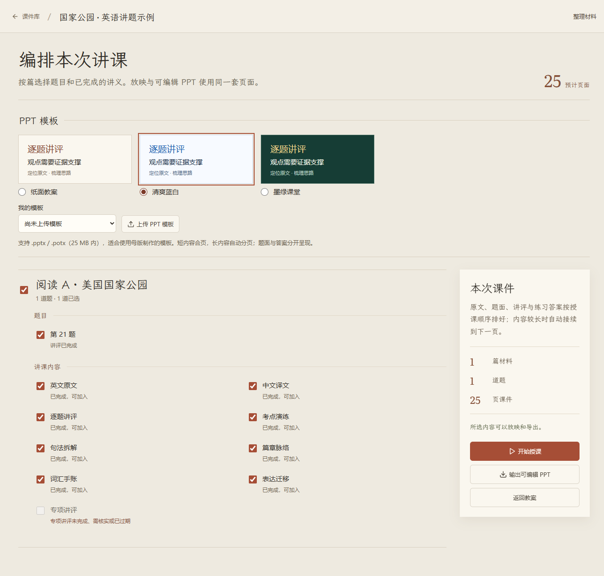

# 讲题工作台 · Lesson Desk

[English](README.md) | [简体中文](README.zh-CN.md)

把手头的试卷整理成讲评教案和课堂课件。讲题工作台是一款桌面应用，支持英语、语文与化学。导入试卷、核对题目和答案后，可以按需生成讲解，继续修改，再按授课顺序编排和导出。

[下载 Windows 版](https://github.com/zazedwhwhy/lesson-desk/releases/latest) · [Beta 测试版](https://github.com/zazedwhwhy/lesson-desk/releases/tag/v0.17.2-beta.1) · [反馈问题](https://github.com/zazedwhwhy/lesson-desk/issues) · [MIT 许可证](LICENSE)



## 下载

| 版本 | 下载 | 适用场景 |
| --- | --- | --- |
| 正式版 | [0.18.0](https://github.com/zazedwhwhy/lesson-desk/releases/tag/v0.18.0) | 日常备课，不含错题本功能 |
| 测试版 | [0.17.2-beta.1](https://github.com/zazedwhwhy/lesson-desk/releases/tag/v0.17.2-beta.1) | 包含实验性的错题本，标记为预发布 |

在发布页下载 Windows x64 安装器 `LessonDesk-<version>-Setup.exe`。每版附有 `SHA256SUMS.txt` 校验文件。

[macOS 0.18.1 试用版](https://github.com/zazedwhwhy/lesson-desk/releases/tag/v0.18.1-macos.1) 提供 Apple 芯片和 Intel 芯片两种 DMG。安装和验证范围见 [macOS 发布说明](docs/releases/0.18.1.md)。

两版使用独立的安装名称和数据目录。Beta 首次启动复制正式版已有数据，之后分别保存，不双向同步。正式版移除错题本功能时保留原有错题数据。

软件界面目前为中文，仓库文档提供中英文两版。

## 功能

- 导入 PDF、Word（`.docx`），或粘贴题目与参考答案。扫描页通过配置的 AI 服务识别，可以对照原页校订。
- 英语支持逐题解析、译文、长难句拆解、篇章分析、语境词汇与表达迁移练习。
- 语文按材料与题目组织阅读、文言文、诗歌、语言运用和写作任务。
- 化学支持逐题讲评、知识梳理、题型方法、实验剖析与考点演练。自动关联流程图、实验装置图和统计图，教案、放映与 PPT 导出保留原图。
- 通过 MathJax 和 mhchem 离线显示 LaTeX 公式与化学符号。
- 修改生成内容、保留教师修订，继续未完成任务；取消后已完成项仍会保存。
- 自选篇目和模块，按课堂顺序编排。应用内放映与可编辑 PPT 使用相同页序，支持自动分页、练习与答案分开呈现。
- 提供连续讲评、侧栏板书和逐步揭示三种课堂版式，也可导入 `.pptx` / `.potx` 模板，沿用背景、配色和字体。
- 课件保存在本机，可导出备份包。Beta 另提供错题本，收录整题或片段，用于复习与复讲。
- 也可通过 [讲题工作台 Skill](https://github.com/zazedwhwhy/lesson-desk-skill) 在 Hermes Agent 等客户端完成三科备课，包括英语词汇手账和专项讲评。导入和查看课件无需配置工作台 API。[安装与使用](skills/lesson-desk-export/INSTALL.zh-CN.md) · [三科功能](skills/lesson-desk-export/references/workflows.md)

## 开始使用

1. 打开示例，或新建课件并选择学科。
2. 在连接设置填写服务商、基础地址、模型与 API Key；保存的连接可以命名、查看和切换。
3. 导入试卷与参考答案，对照原件核对识别文字、材料关联和答案。
4. 勾选所需教学模块，生成后检查内容并保存修改。
5. 进入授课 / PPT 编排，选择内容和顺序，再放映或导出。

浏览示例不需要 API Key。AI 功能使用自己的服务账号，可能产生调用费用。

## AI 连接

| 服务商选项 | 默认基础地址 | 协议 |
| --- | --- | --- |
| OpenAI | `https://api.openai.com/v1` | Responses |
| Claude（Anthropic） | `https://api.anthropic.com/v1` | Messages |
| DeepSeek | `https://api.deepseek.com` | Chat Completions |
| OpenAI 兼容接口 | 服务商提供的基础地址 | Chat Completions |

填写账号实际可用的模型。扫描识别与图片任务需要模型支持图片输入。使用代理时，选择代理支持的协议，地址末尾不要添加 `/responses`、`/messages` 或 `/chat/completions`。

AI 任务会把所需材料发给选定的服务商。调用失败后不会自动切换服务商或模型；发送前请确认材料使用权限与服务配置。

## 本地数据与输出

课件、设置与模板保存在应用的本机用户数据目录。API Key 使用 Electron `safeStorage` 加密，课件备份包不含 API 凭据。

授课前请核对 OCR、答案和生成讲解。未解决的来源差异保留供核查。暂不支持旧版 `.doc` 和音频转写。

自定义 PPT 模板提供版式、背景、装饰与主题，模板示例文字不会进入课件。复杂模板或缺失字体可能影响显示，请用实际授课软件检查导出文件。

## 从源码运行

在 Windows 安装 Node.js 24 LTS 与 Git。下面的命令使用当前正式版对应的源码。

```powershell
git clone https://github.com/zazedwhwhy/lesson-desk.git
cd lesson-desk
git checkout v0.18.0
npm ci
npm run build
npm start
```

| 命令 | 用途 |
| --- | --- |
| `npm run dev` | 浏览器界面预览；导入、存储和 AI 等桌面功能需要 Electron |
| `npm test` | 使用合成材料与模拟请求运行本地自动化测试 |
| `npm run check:public` | 检查已跟踪文件中的私人数据与凭据 |
| `npm run build` / `npm run package` | 构建 / 打包正式版 |
| `npm run package:mac` | 在 macOS 上生成当前架构的试用 DMG |
| `npm run build:beta` / `npm run package:beta` | 构建 / 打包测试版 |

安装器输出到 `release/`，两版构建产物分别保存。应用使用 Electron、React 与 TypeScript。

## 文档与参与

- [0.18.0 发布说明](docs/releases/0.18.0.md)
- [0.18.1 macOS 发布说明](docs/releases/0.18.1.md)
- [版本历史](docs/版本历史.md)
- [贡献指南](CONTRIBUTING.md)
- [开发与 Git 工作流](docs/开发与Git工作流.md)

反馈问题时请附上软件版本、学科、复现步骤和相关报错。上传附件前移除 API Key、个人与学生信息。

## 许可证

自行编写的源码采用 [MIT](LICENSE)。Literata 与霞鹜文楷保留 SIL Open Font License 1.1 授权；其他组件见[第三方声明](THIRD_PARTY_NOTICES.md)。上传材料保留其原有许可。
