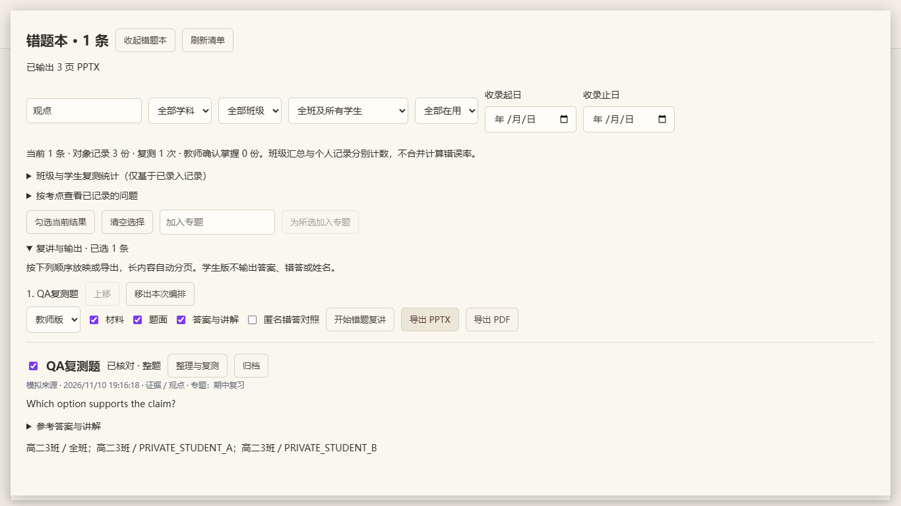

## 0.17.2 正式版 / 0.17.2-beta.1 测试版

正式版移除错题本入口、收录栏与后台接口，已有错题数据保留。需要错题本时使用名称中带 **Beta** 的测试版。

Beta 保留修复后的错题本：收录栏移至页首正常布局，不再遮挡任务提示和取消按钮；设置、授课编排与放映不显示收录栏。管理窗口使用模态对话框，关闭和 Escape 都会检查未保存编辑。修复化学片段来源、讲义模块关联、整段收录混入界面段号的问题，并补充化学公式显示。

两版有独立安装名称和数据目录。Beta 首次启动复制正式版现有课件、连接及错题数据，随后各自保存，不双向同步。详见 [双版本交付说明](https://github.com/zazedwhwhy/lesson-desk/blob/v0.17.2/docs/双版本与错题本-0.17.2.md)。

开发：`npm run build` / `npm run package` 生成正式版；`npm run build:beta` / `npm run package:beta` 生成测试版。两套构建产物互不覆盖。

## 0.17.1 化学题图自动显示

整理化学 PDF / Word 试卷时，AI 自动识别流程图、实验装置、统计曲线等图示，程序保留原图并关联题目。题图直接显示在题面核对、教案讲解（包括只看讲解）、放映和 PPT 中；无需逐张附图或选择显示方式，公式继续使用 LaTeX。

识图按页保存进度，重试复用已完成页面。自动题图随整题核对；少数未确定归属的图会保留并显示在待关联区。详见 [0.17.1 改动与验证](https://github.com/zazedwhwhy/lesson-desk/blob/v0.17.2/docs/化学自动题图-0.17.1.md)。

## 0.17.0 正式版

保留纸面教案界面，连接设置支持命名、多连接切换、查看已保存配置和按需显示密钥。返回入口位于页首，离开未保存编辑时提醒；设置草稿不改变正在使用的连接。

修复全部任务模板替换时丢失题号范围、数量与修正要求的问题，调整语文教学、英语词汇和新编练习提示，固定化学演练的题目、答案、解析结构。英语长卷校对最多三段并行，仍按原顺序合并。未知程序异常停止后续生成，原题找不到对应题号时明确列为待核实。

本版整合 beta.2–11 的三科工作流、离线公式、OpenAI/Claude、OCR 核对、整卷补漏与三任务并行。首次启动把旧工作数据复制到独立的正式版目录，原数据保留。详见 [正式版改动与验证](https://github.com/zazedwhwhy/lesson-desk/blob/v0.17.2/docs/正式版-0.17.0.md) 和 [回退审计](https://github.com/zazedwhwhy/lesson-desk/blob/v0.17.2/docs/audits/2026-11-16-fallback-audit.md)。

## 0.17.0-beta.11 化学上传流程

化学PDF上传后进入待识别状态，在上传试卷、上传答案旁直接显示“AI识别”按钮。即使PDF已有文字层，也须点击识别，再核对、整理试卷；不会把自动提取文字当作AI识别完成。旧版已上传材料也可直接点击AI识别，原有题目与讲评保留。

## 0.17.0-beta.10 化学导入与校对修复

修复考生注意序号误匹配试题、跨页页眉页脚混入比较范围，以及综合题子问选项重复导致的保真误报。差异报告默认折叠，化学可本地重新检查当前题目，或按三题一批进行 AI 对照原卷校对；报告明确文字检查与题图未核验范围。

三学科的 PDF 材料均可按选定页码重新识别，即使已有文字层；识别前文字逐页保留，可在 OCR 核对中恢复。识别不自动替换已有题目、答案和讲评。化学附入原页默认使用当前题目的来源与页码。

## 0.17.0-beta.9 英语与化学漏题补齐

英语、化学整理后对照原材料检查题号覆盖；部分返回或输出截断时自动分段补齐，补发保留阅读材料、共用实验条件和跨页续文。仍未返回的题目会明确列在整理报告中。旧课件可点击“补齐遗漏题目（保留已有讲评）”，已有题目、核对状态、题图与讲评保持不变。英语同时检查行内空号及明确的应用文、读后续写任务，并按试卷来源区分同号题。

## 0.17.0-beta.8 语文整卷补齐

语文整理按阅读、默写、语言运用、作文等篇目分开发送，逐篇核对来源题号，避免只返回第一篇就被当作整卷完成。遗漏篇目会单独重试并显示报告。打开旧课件时可点击“补齐剩余篇目”，完整且原文未变化的已有篇目及其讲评保留，无需重新上传或扫描原卷。

## 0.17.0-beta.7 长材料自动分段校对

英语原卷校对不再因超过16万字符而拒绝发送。程序按题目、关联篇目与来源块拆分请求，逐段显示进度，再合并问题和覆盖范围；服务明确拒绝上下文长度时，会继续细分当前段重试。原材料不会被截断，校对不会修改原题和答案。特别长的单项文字会分片并明确提示跨片上下文仍需人工核实。取消、服务或结果校验失败时保留旧报告，不伪造整卷通过。

## 0.17.0-beta.6 并行生成与参考答案

英语、语文、化学的教学任务最多同时处理3项，当前任务及逐项列表显示生成、复核、重试阶段和本次耗时。各项完成后独立保存；同篇模块的结果分别合并，磁盘写入顺序执行。取消后保留已保存内容，继续时跳过已完成项；有依赖的原题解析与练习按先后顺序执行。并发上限针对任务，任务内部的生成和复核仍有先后关系。

上传或教师确认的参考答案是原题讲评的依据，不要求AI重新作答替换答案。英语解析答案偏离参考答案时只修正该题，不保存矛盾候选；缺少答案时明确标注AI建议待核实。新编练习使用其自身的独立答案。

## 0.17.0-beta.5 原题差异报告

整理时发现题干、选项、答案或材料与来源不一致，不再因此中断整卷整理。英语、语文、化学均保存候选内容与差异清单，在备课页显示具体位置、来源文字及 AI 整理文字，供教师修改和核对。报告是本次整理的检查快照；候选题目不会被自动标记为已核对。

## 0.17.0-beta.4 OCR 核对

OCR 核对支持跨试卷与答案勾选页面、全选待核对页，并一次保存所选页的人工核对结果。未识别完成的页不能通过；有未保存校订的页需先保存。可在软件中显示原图，也可对照已打开的原 PDF 后确认，原图加载不再锁住所有核对按钮。

原图加载显示进度，支持取消、超时后重试；校订一页不会清除其他页未保存的草稿。保留原始 OCR 转录与校订记录，批量通过表示教师已核对所选页，不是 AI 自动认定内容正确。

## 0.17.0-beta.1 化学测试版

新增图文化学题目、逐题讲评、知识梳理、题型方法、实验剖析和考点演练。保留 PDF 原页与题图，可按题目/模块生成和编排，共享课堂/PPT 页序；旧讲义和教师修改保留。测试版采用独立安装名称与数据目录。详见 [化学测试版使用说明](https://github.com/zazedwhwhy/lesson-desk/blob/v0.17.2/docs/化学测试版-0.17.0-beta.1.md)。

## 0.16.1 更新

优化英语与语文的整理备课页：材料核对、模块多选生成与导出入口按步骤组织，显示本次范围、所用服务及逐项进度。生成失败或取消后保留已保存内容，支持沿用上次范围继续未完成项。导出入口明确区分可编辑 PPT 与备份课件包，PPT 仍须先由教师选择内容并编排。讲课、阅读、放映、错题本与模板布局保持原有设计。

详见 [备课界面优化](https://github.com/zazedwhwhy/lesson-desk/blob/v0.17.2/docs/备课界面优化-0.16.1.md)。

## 0.16.0 更新

新增本地错题本：课堂收录整题与内容片段，按班级和学生记录错因与复测，按考点、专题和复习日期筛选，编排复讲并导出教师版／学生版 PPT、PDF。支持图片快照、关联考点演练、归档恢复和旧数据兼容。学生版需教师确认题面、材料和图片不含答案。

详见 [错题本使用说明](https://github.com/zazedwhwhy/lesson-desk/blob/v0.17.2/docs/错题本-0.16.0.md)。

